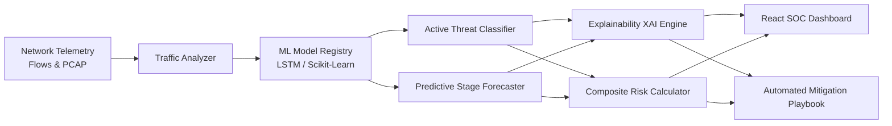

<div align="center">

# CyberNetra AI (साइबरनेत्रा)

### **AI-Powered Threat Intelligence & Predictive Network Attack Forecasting System**

[](https://fastapi.tiangolo.com)
[](https://reactjs.org/)
[](https://tailwindcss.com/)
[](https://python.org)
[](https://attack.mitre.org/)
[](https://sih.gov.in)
[](https://opensource.org/licenses/MIT)

<p align="center">
  <b>Transforming Cyber Defense from Reactive Alert Triage to Proactive Attack Stage Forecasting.</b>
</p>

</div>

---

## Table of Contents

- [The Problem: Why Reactive Security Fails](#-the-problem-why-reactive-security-fails)
- [The Solution: What is CyberNetra AI?](#-the-solution-what-is-cybernetra-ai)
- [How It Works: End-to-End Pipeline](#-how-it-works-end-to-end-pipeline)
- [Core Features & Innovations](#-core-features--innovations)
- [MITRE ATT&CK Kill-Chain Mapping](#-mitre-attck-kill-chain-mapping)
- [Project Architecture & Directory Layout](#-project-architecture--directory-layout)
- [Quick Start Guide](#-quick-start-guide)
- [Live Demo Guide for Evaluators & Judges](#-live-demo-guide-for-evaluators--judges)
- [REST API Reference](#-rest-api-reference)
- [License & Acknowledgements](#-license--acknowledgements)

---

## 🛑 The Problem: Why Reactive Security Fails

Traditional Security Information & Event Management (SIEM) and Intrusion Detection Systems (IDS) are **historically reactive**:
- They trigger alarms **after** data has been exfiltrated or ransomware has executed.
- Security Operation Center (SOC) analysts suffer from **alert fatigue**—drowning in thousands of isolated logs with zero temporal context.
- Existing tools tell you **"what just broke"**, but never **"what the adversary will strike next."**

| Capability | Traditional SIEM / Rule-Based IDS | CyberNetra AI Predictive Defense |
| :--- | :--- | :--- |
| **Detection Timing** | Post-Exploitation (After compromise) | **Pre-Exploitation (During early reconnaissance/auth)** |
| **Temporal Prediction** | ❌ None (Static thresholds) | **Predicts next attack phase & time-to-impact ETA** |
| **Context & Explainability** | Raw log dumps & cryptic alert IDs | **Dual-Wing XAI ("What Happened" + "What's Next")** |
| **Mitigation** | Manual SOC triage (slow response) | **Automated, step-by-step mitigation playbooks** |
| **Model Extensibility** | Vendor-locked proprietary engines | **Drop-in model registry for PyTorch, Scikit-Learn & ONNX** |

---

## 🛡️ The Solution: What is CyberNetra AI?

**CyberNetra AI** (*derived from the Sanskrit "Netra" meaning "Eye of Foresight"*) is an intelligent network defense prototype developed for the **Smart India Hackathon (SIH 2026)**.

It ingests high-velocity network flow telemetry, identifies active attack vectors, and uses **multi-stage sequence modeling (LSTM & Bayesian State Transitions)** to forecast the attacker's trajectory along the cyber kill-chain **5 to 15 minutes before the next stage occurs**.

```
  [ Live Flow Telemetry ]
           │
           ▼
  ┌─────────────────────────────────────────────────────────────┐
  │                   CYBERNETRA AI CORE ENGINE                 │
  │                                                             │
  │  1. Feature Extractor  ──►  Packet Rate, SYN Ratio, Auth    │
  │  2. Threat Detector    ──►  Active Vector Classification    │
  │  3. Forecast Engine    ──►  LSTM Next-Stage Kill-Chain ETA  │
  │  4. XAI Engine         ──►  Retrospective & Prospective XAI │
  │  5. Risk Calculator    ──►  Composite Threat Index (0-100)  │
  └─────────────────────────────────────────────────────────────┘
           │
           ▼
  [ Real-Time SOC Command Center & Automated Mitigation Playbook ]
```

---

## ⚡ How It Works: End-to-End Pipeline



1. **Telemetry Ingestion**: Continuous ingestion of raw flow metrics (packets/sec, bytes/sec, SYN flag ratios, failed login attempts, port distribution).
2. **Feature Normalization**: Extraction of statistical baselines (mean, variance, and 3-sigma anomaly deviations).
3. **Active Classification**: ML models identify current malicious behaviors (e.g., Subnet Port Sweep, SSH Brute Force, UDP Flood).
4. **Predictive Stage Forecasting**: Sequential time-series models predict the transition probability to the next kill-chain stage (e.g., from *Reconnaissance* $\rightarrow$ *Credential Access* $\rightarrow$ *Privilege Escalation*).
5. **Explainable AI (XAI) Synthesis**: Explains *why* the threat was flagged and *what evidence* supports the forecast.
6. **SOC Alerting & Mitigation**: Presents interactive visualizations and recommended firewall/IAM rules to the operator.

---

## 🌟 Core Features & Innovations

### 1. 🔮 Attack Stage Progression Forecasting (Flagship Feature)
Rather than simply classifying an isolated event, CyberNetra evaluates the **temporal progression** of an ongoing attack.
- Displays an interactive **MITRE ATT&CK Kill-Chain Roadmap**.
- Estimates **Time to Next Attack Stage (ETA)** with a probabilistic confidence score.
- Identifies **high-value target assets** at risk (e.g., Domain Controllers, Database Clusters).

### 2. 🔍 Dual-Wing Explainable AI (XAI)
Every alert provides instant, human-understandable clarity:
- **What Happened Until Now (Retrospective Evidence)**: Highlights specific telemetry metrics exceeding normal baseline limits (e.g., `Failed Logins: 54 (+980% above baseline)`).
- **What Is Going To Happen Next (Prospective Trajectory)**: Outlines the predicted attack path, anticipated impact, and attacker objective.
- **Automated Mitigation Playbook**: Step-by-step containment instructions (e.g., block subnet CIDR, enable MFA lockouts, isolate port 22/3389).

### 3. 📊 Dual-Axis Real-Time Telemetry Visualizer
- Synchronized dual-axis time series chart displaying **Packet Frequency (pkts/s)** alongside **Active Connection Spikes**.
- Dynamically highlights anomalous intervals and attack onset windows.

### 4. 🎛️ Interactive 4-Scenario Threat Simulator
Evaluate system behavior on demand with 1-click test scenarios:
- **Normal Baseline**: Healthy enterprise network flow (10/100 risk).
- **Suspicious Reconnaissance**: Distributed port sweeps and vulnerability scanning.
- **Attack Progression**: Active credential brute forcing escalating towards privilege escalation.
- **Volumetric DDoS**: UDP/SYN flood exceeding 20,000 packets/second.

### 5. 🧩 Drop-In Model Registry (`backend/models/saved_models/`)
- Supports **PyTorch (`.pt`)**, **Scikit-Learn / Joblib (`.pkl`)**, and **ONNX** models.
- Simply drop a newly trained model file into the directory—CyberNetra auto-detects and loads it dynamically without server restarts.
- Built-in UI to view model metadata, active status, and trigger retrain pipelines on benchmark datasets (e.g. UNSW-NB15).

---

## 🎯 MITRE ATT&CK Kill-Chain Mapping

| Kill-Chain Phase | MITRE Technique ID | Observed Indicators | Predicted Next Stage | Recommended Action |
| :--- | :--- | :--- | :--- | :--- |
| **Reconnaissance** | `T1046` (Network Service Discovery) | High SYN/ACK ratios, sequential port sweeps | Credential Access (`T1110`) | Apply rate-limiting & drop unsolicited SYN bursts |
| **Credential Access** | `T1110` (Brute Force) | Multi-account login failures on SSH/RDP | Privilege Escalation (`T1068`) | Enforce IP lockout, rotate admin tokens |
| **Privilege Escalation** | `T1068` (Exploitation for Privilege) | Sudo abuse, unauthorized permission changes | Lateral Movement (`T1021`) | Isolate endpoint & terminate unauthorized sessions |
| **Impact / Denial** | `T1498` (Network DoS) | Volumetric flood, link saturation (>20k pkts/s) | Infrastructure Outage | Enable upstream BGP blackholing / Cloudflare scrubbing |

---

## 📂 Project Architecture & Directory Layout

```text
CyberNetra/
├── backend/                            # FastAPI Server & AI/ML Pipeline
│   ├── main.py                         # Application entrypoint & REST routes
│   ├── requirements.txt                # Python backend dependencies
│   ├── test_endpoints.py               # Automated test suite
│   ├── models/
│   │   ├── schemas.py                  # Pydantic data validation schemas
│   │   ├── model_loader.py             # Dynamic model detector & loader
│   │   └── saved_models/               # Model weights repository (.pkl, .pt)
│   ├── services/
│   │   ├── traffic_analyzer.py         # Network flow feature extraction
│   │   ├── threat_detector.py          # Threat vector classifier
│   │   ├── forecast_engine.py          # Attack stage progression forecaster
│   │   ├── risk_calculator.py          # 0-100 composite risk scoring
│   │   ├── explainability_engine.py    # XAI evidence generator
│   │   └── training_engine.py          # Automated model retrain pipeline
│   └── data/
│       ├── simulated_traffic.json      # 15-minute multi-scenario telemetry
│       └── datasets/                   # Benchmark training datasets
│
├── frontend/                           # React + Vite SOC Web Dashboard
│   ├── src/
│   │   ├── App.jsx                     # Dashboard state and layout
│   │   ├── index.css                   # Cyberpunk dark SOC theme & tokens
│   │   ├── services/
│   │   │   └── api.js                  # Axios/Fetch backend client
│   │   └── components/
│   │       ├── Header.jsx              # Status banner & live system pulse
│   │       ├── Navbar.jsx              # Primary navigation tabs
│   │       ├── StatCards.jsx           # Posture, endpoints & anomaly stats
│   │       ├── TrafficChart.jsx        # Dual-axis Recharts telemetry graph
│   │       ├── RiskScore.jsx           # Radial SVG threat gauge (0-100)
│   │       ├── AttackForecast.jsx      # MITRE ATT&CK progression forecast
│   │       ├── ExplainabilityPanel.jsx # Dual-wing XAI evidence & playbook
│   │       ├── Alerts.jsx              # SOC alert incident feed
│   │       ├── SimulationControls.jsx # 4-scenario simulation switcher
│   │       └── ModelRegistryView.jsx  # ML model deployment & upload manager
│   ├── package.json                    # Frontend dependencies & scripts
│   └── vite.config.js                  # Vite bundler configuration
│
├── .gitignore                          # Standard git ignore rules
└── README.md                           # Documentation & user manual
```

---

## 🚀 Quick Start Guide

### Prerequisites
- **Python**: Version `3.10` or higher
- **Node.js**: Version `18.0` or higher & `npm`
- **Git**: Installed and configured

---

### Step 1: Clone the Repository

```bash
git clone https://github.com/Krupal-ApexAI/CyberNetra.git
cd CyberNetra
```

---

### Step 2: Set Up and Run the Backend

```bash
# Optional: Create and activate a virtual environment
python -m venv venv
# On Windows:
venv\Scripts\activate
# On Linux/macOS:
source venv/bin/activate

# Install Python dependencies
pip install -r backend/requirements.txt

# Start the FastAPI ASGI server
python -m uvicorn backend.main:app --host 0.0.0.0 --port 8000 --reload
```

- **Backend API**: `http://localhost:8000`
- **Interactive OpenAPI (Swagger) Docs**: `http://localhost:8000/docs`
- **Health Check**: `http://localhost:8000/api/health`

---

### Step 3: Set Up and Run the Frontend

Open a **new terminal window** in the project directory:

```bash
cd frontend

# Install node dependencies
npm install

# Start the Vite development server
npm run dev
```

- **SOC Web Dashboard**: Open your browser at **`http://localhost:5173`**

---

## 🎬 Live Demo Guide for Evaluators & Judges

Follow this **2-minute evaluation sequence** to experience all capabilities:

1. **Baseline State (`Normal Baseline`)**:
   - The dashboard opens in standard operational mode.
   - Observe **Low Risk Score (~10/100)**, green system status, and nominal network metrics (~178 pkts/s).
2. **Reconnaissance Detection (`Suspicious Recon`)**:
   - Click the **Suspicious Recon** scenario button.
   - The system flags port scanning on internal subnet `192.168.1.0/24`.
   - The **Forecasting Engine** predicts an impending **Credential Access / Brute Force** attack within 10-15 minutes.
3. **Attack Progression & Prediction (`Attack Progression`)**:
   - Click **Attack Progression**.
   - Notice the risk gauge jump to **Critical (77/100)**.
   - The **Dual-Wing XAI Panel** highlights:
     - *Evidence*: 54 failed authentication attempts across SSH/RDP.
     - *Forecast*: High probability of **Privilege Escalation & Lateral Movement** in 5-10 minutes.
     - *Mitigation*: Actionable playbook to isolate affected subnet IPs and enforce MFA.
4. **Volumetric Denial of Service (`DDoS Attack`)**:
   - Click **DDoS Attack**.
   - Watch the telemetry graph spike to **>21,000 pkts/s**.
   - The system triggers service degradation warnings and automated BGP/firewall mitigation rules.
5. **Model Registry & Auto-Loading (`Model Registry` Tab)**:
   - Navigate to the **Model Registry** tab to see active ML/DL models, upload new weights (`.pkl`, `.pt`, `.onnx`), or test the automated dataset training workflow.

---

## 📡 REST API Reference

| HTTP Method | Endpoint | Description |
| :--- | :--- | :--- |
| `GET` | `/api/health` | Returns service status, timestamp, and active model count |
| `GET` | `/api/scenarios` | Lists all pre-configured simulation scenarios |
| `POST` | `/api/analyze` | Ingests telemetry array and returns threat analysis, risk score, forecast, and XAI |
| `GET` | `/api/models` | Lists all discovered and active ML models in `saved_models/` |
| `POST` | `/api/models/upload` | Multipart upload for custom model weights (`.pkl`, `.pt`, `.onnx`) |
| `POST` | `/api/models/train` | Triggers background training pipeline on benchmark datasets |

---

## 📜 License & Acknowledgements

- **License**: Distributed under the [MIT License](https://opensource.org/licenses/MIT).
- **Developed For**: **Smart India Hackathon (SIH 2026)**
- **Theme**: Blockchain & Cybersecurity
- **Problem Statement ID**: SIH26153 (National Technical Research Organisation - NTRO)
- **Author**: Team ApexAI (`Krupal-ApexAI`)
